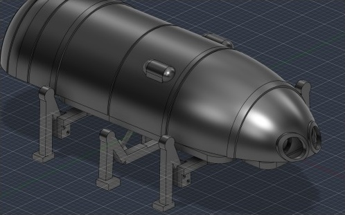

# Springtail P1

Springtail P1 is a student engineering project exploring insect-inspired tripod gait, ultrasonic obstacle sensing, and a spring-loaded jump mechanism.

[View the project site](https://springtail-p1.github.io/insect-inspired-adaptive-walker/)

## Project files

- [Springtail Robot Assembly Manual — Rev F](springtail-assembly-rev-f.pdf) — six sheets covering the chassis, linkages, furca, wiring, and parts list.
- [Springtail Inventor kinematics joint sheet](springtail-inventor.pdf) — assembled views, joints, and kinematic notes for the Inventor model.
- [Tinkercad circuit image](springtail-circuit.png) — Arduino Uno R3, three servos, two ultrasonic sensors, and an L293D-driven DC motor.
- [Original design references](index.md) and [reference leg model](leg-hrl.ipt).

The Tinkercad circuit and the Inventor model document different P1 configurations from the Rev F build. The Rev F manual describes its own four-servo wiring and hinged furca mechanism, and flags rocker-servo torque for validation.

## Project team

- Mohamed Ibrahim Awad
- Abdullah Alzubaidi
- Abdallah Arafat
- Marjan Shadmani Fard
